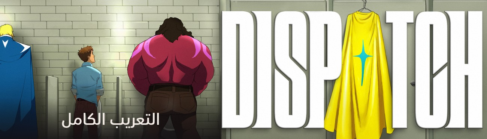

# Dispatch - التعريب الكامل

تعريب كامل لـDispatch على Steam بالعربية الفصحى: 12,118 سطرًا تشمل الحلقات الثماني كلها، من الحوارات واختياراتك إلى نوبات التوزيع ببلاغاتها وملفات أبطالها، إلى جانب القوائم والإعدادات. تُضاف العربية لغةً جديدة، وتبقى اللغات الأخرى كما هي.

## التحميل

من صفحة [الإصدارات](../../releases/latest) حمّل ملف `Dispatch-Arabic-v1.1.0.exe`.

## التثبيت

1. أغلق اللعبة.
2. شغّل المثبّت، واختر خط الحوارات (مرحي أو SST)، ثم اضغط «تثبيت اللغة العربية». يجد المثبّت اللعبة تلقائيًا من مكتبة Steam، ويمكنك اختيار مجلدها يدويًا.
3. شغّل اللعبة فتظهر بالعربية. إن بقيت بلغة أخرى فاجعل «اللغة» في الإعدادات على «System».

إن ظهرت رسالة "Windows protected your PC" اضغط More info ثم Run anyway.

لتغيير خط الحوارات لاحقًا: شغّل المثبّت، اختر الخط الآخر، واضغط «تغيير خط الحوارات».

للإزالة: شغّل المثبّت واضغط «إزالة اللغة العربية»، فتعود اللعبة كما كانت.

## ما يميّز هذا التعريب

- **الترجمة النصية والاختيارات بخط مرحي أو SST حسب اختيارك:** تختار الخط في المثبّت، والحروف متصلة ومن اليمين إلى اليسار، وبقية الواجهة بخط SST Arabic.
- **دون قلب تصميم الشاشات:** تبقى القوائم ولوحات البلاغات في أماكنها كما في النسخة الإنجليزية.
- **مخاطبة تتبع السياق:** صيغة المذكر والمؤنث والجمع في الحوار بحسب المتحدث ومن يُوجَّه إليه الكلام.
- **مثبّت بضغطة واحدة:** يجد اللعبة ويضبط لغتها، ويُزيل التعريب بالضغطة نفسها. لا يُعدَّل أي ملف من ملفات اللعبة.

## تنبيه

- لا تظهر «العربية» في قائمة لغات اللعبة، فالقائمة ثابتة داخلها. المثبّت يضبط اللعبة على العربية من ملف إعداداتها، فأبقِ «اللغة» على «System».
- أسماء المستخدمين ومسارات الحاسوب والرموز تبقى بالإنجليزية كما تظهر في اللعبة.
- اسم المتحدث في الترجمة النصية بلون السطر نفسه.
- صُمّم لإصدار Steam، رقم البناء 25637711. بعد أي تحديث للعبة انتظر نسخة جديدة من التعريب.
- أخبرنا بأي نص غير مترجم أو خارج مكانه مع صورة في [Issues](../../issues).

## شكر وتقدير

- AdHoc Studio على اللعبة.
- خط Marhey مرخّص برخصة SIL Open Font License 1.1.
- خط Rubik في المثبّت مرخّص برخصة SIL Open Font License 1.1.

أعجبك التعريب؟ ادعمني على Ko-fi: https://ko-fi.com/kindiboy

---

Full Arabic localization of Dispatch (Steam, build 25637711): 12,118 lines in Modern Standard Arabic covering all eight episodes (dialogue, your choices, the dispatch shifts with their calls and hero files) plus the menus and settings. Arabic is added as a new language; the other languages stay as they are. Subtitles and choices use the Marhey or SST Arabic font (picked in the installer), the rest of the interface SST Arabic. The installer adds one pak file and sets the game's language to Arabic in its settings file; no game file is changed. Download the installer from [Releases](../../releases/latest).

This is a fan project, not affiliated with or endorsed by AdHoc Studio. Dispatch is a trademark of its respective owners.
